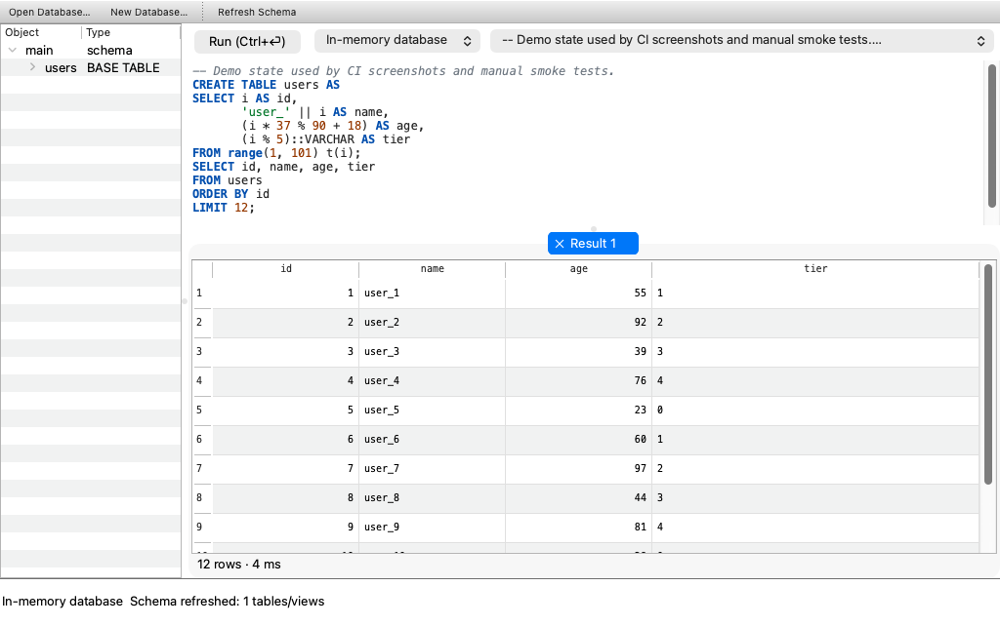
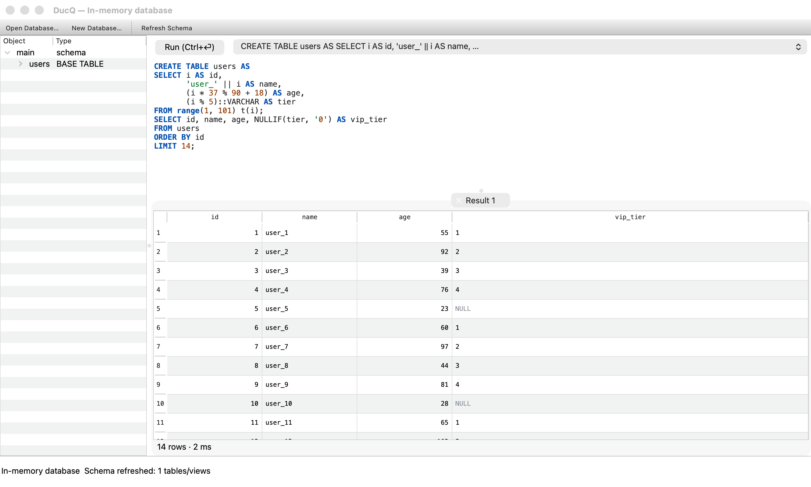

# DucQ 🦆

English | [简体中文](README.zh_CN.md)

A cross-platform [DuckDB](https://duckdb.org) desktop client — pure C++ / Qt Widgets / DuckDB v1 C API, statically linked for single-binary distribution.



*Schema tree, SQL editor with highlighting, and a virtualized result table — the query above created the `users` table from a `range()` and reads it back.*



*NULLs render in gray, numeric columns right-align, and every query opens in its own result tab.*

## Features

- Open / create `.duckdb` database files; an in-memory database works out of the box
- Schema tree: tables / views / columns grouped by schema, double-click to generate a `SELECT`
- SQL editor: keyword / string / comment highlighting, `Ctrl+Enter` to execute
- Result table: virtualized rendering, shows the first 1,000,000 rows by default (marked "truncated" beyond that)
- Query progress bar + cancel at any time (`duckdb_interrupt`)
- Drag in `csv / tsv / parquet / json` files to auto-create views and preview them
- Export results to CSV / Parquet (`COPY` streams server-side, unaffected by the display row limit)
- Query history with quick re-run
- UI in 9 languages, switchable at runtime from the menu: English, 简体中文, 日本語, 한국어, Deutsch, Français, Español, Português (Brasil), Русский

## Build

Requirements: CMake ≥ 3.24, Ninja, Qt ≥ 6.4 (Widgets + Test), a C++20 compiler. DuckDB v2.0.0 static libraries are downloaded automatically by CMake FetchContent (SHA256-verified) — nothing to install manually.

```bash
# macOS (Homebrew Qt)
cmake -B build -G Ninja -DCMAKE_BUILD_TYPE=RelWithDebInfo -DCMAKE_PREFIX_PATH="$(brew --prefix qt)"
cmake --build build
open build/DucQ.app

# Linux
sudo apt install qt6-base-dev ninja-build cmake
cmake -B build -G Ninja -DCMAKE_BUILD_TYPE=RelWithDebInfo
cmake --build build
./build/DucQ

# Windows (MSVC + Qt via aqt/install-qt-action)
cmake -B build -G Ninja -DCMAKE_BUILD_TYPE=RelWithDebInfo
cmake --build build
.\build\DucQ.exe
```

Tests: `ctest --test-dir build --output-on-failure`

Three-platform CI: see [.github/workflows/build.yml](.github/workflows/build.yml).

## Technical notes

- **Threading model**: one worker `QThread` per database; queries are driven there through `duckdb_pending_prepared` + `duckdb_pending_execute_task`, and the UI talks to the query layer only via queued signal/slot. `duckdb_interrupt` provides cross-thread cancellation.
- **Result access**: execution finishes into a materialized result (in 2.0, `duckdb_pending_prepared` materializes by default). The `duckdb_result` is handed to the UI thread, which converts cells lazily with the `duckdb_value_*` accessors — safe for any internal vector layout, without ever touching raw flat pointers.
- **Static extensions**: DuckDB 2.0's statically linked extensions (parquet/json/icu/…) must be registered with `duckdb_register_static_extension(<ext>_describe)` before the first `duckdb_open()`; see `src/core/StaticExtensions.cpp`.
- **Large result sets**: materialized results stay in memory; add a `LIMIT` in SQL for very large data (exports go through `COPY`, which streams server-side and is unaffected).

## Roadmap

- [ ] Streaming display for huge result sets (server-side paging / automatic LIMIT wrapping)
- [ ] SQL autocompletion (the autocomplete extension is already statically linked)
- [ ] Built-in charts, result filtering & sorting
- [ ] Packaged distribution (macOS notarization / Windows installer / AppImage)

To add or update a translation: run `lupdate src tests -ts translations/ducq_<lang>.ts`, fill in
`scripts/fill_translations.py` (or edit the `.ts` directly), then `lrelease`. The compiled `.qm`
files are embedded via `src/translations.qrc`.

## License

GPL-3.0 (Qt open-source edition). DuckDB is MIT-licensed; static linking is compatible.
