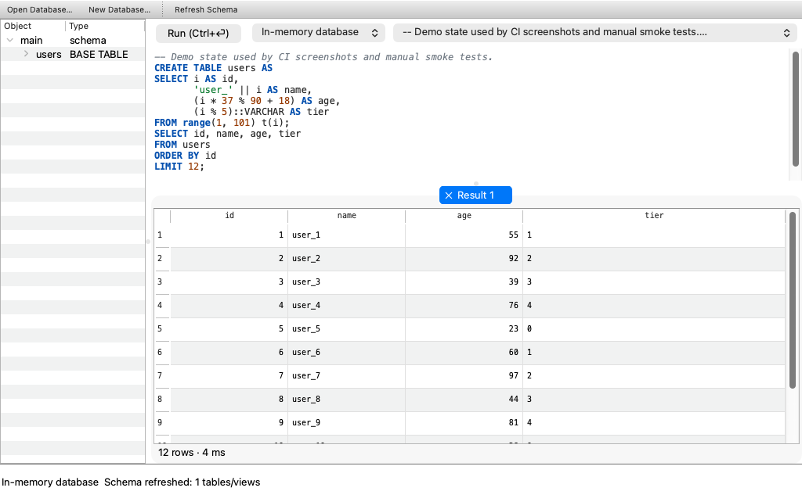
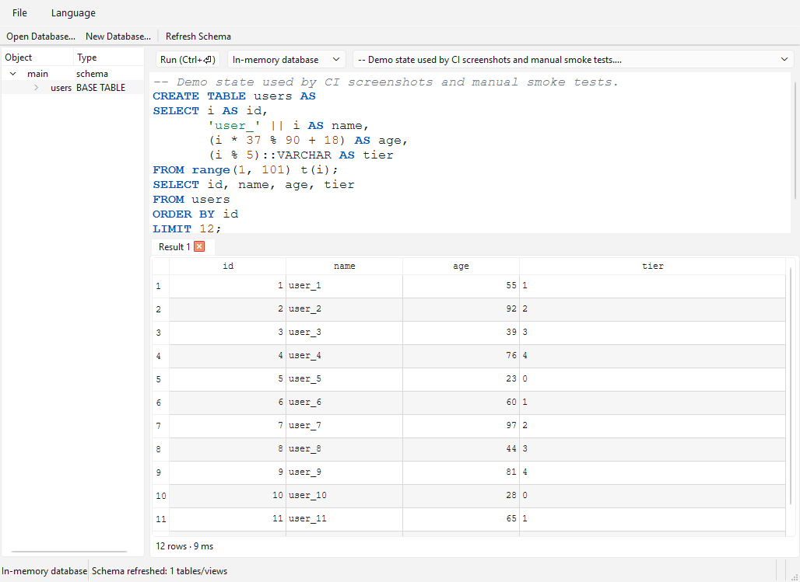
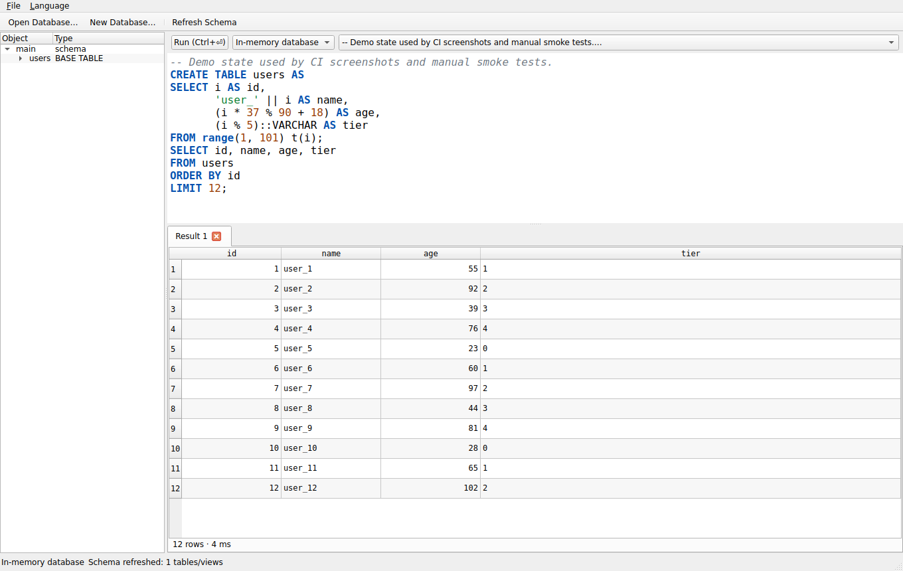
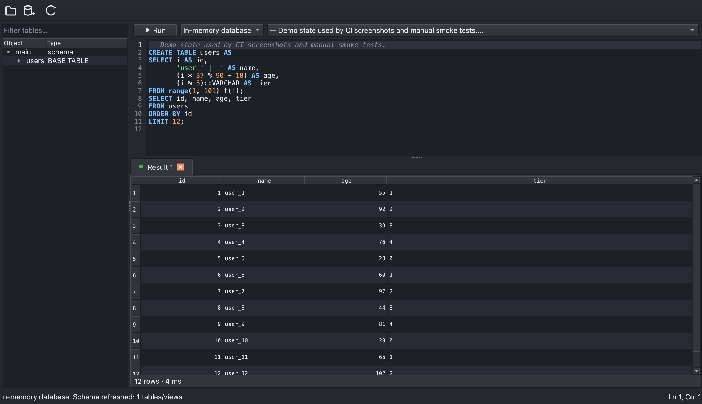
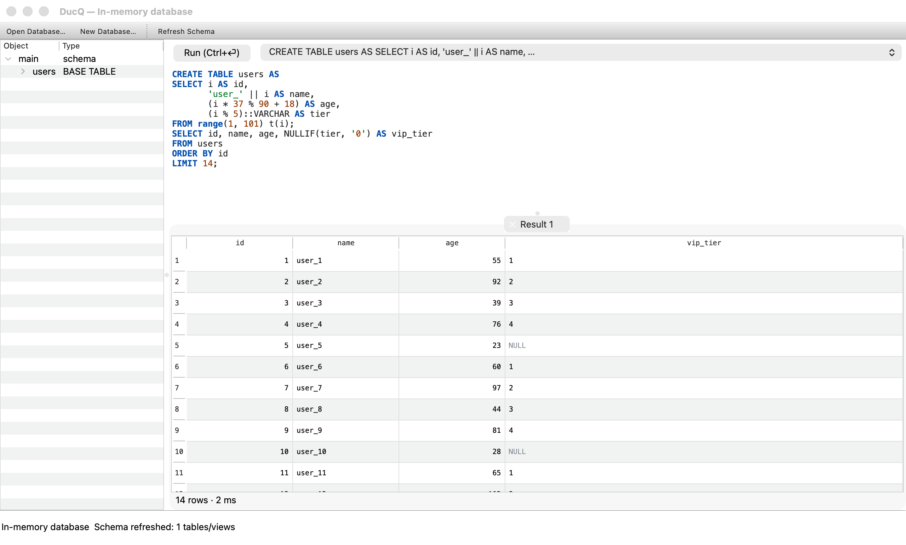

# DucQ 🦆

[English](README.md) | 简体中文

跨平台 [DuckDB](https://duckdb.org) 桌面客户端 —— 纯 C++ / Qt Widgets / DuckDB v1 C API，静态链接，单文件分发。



*模式树、连接选择器、SQL 高亮编辑器与虚拟化结果表格 —— 上图中的 `users` 表由 `range()` 直接生成并读回。截图由 CI 在每次 push 时于各平台无头采集。*

<details>
<summary>Windows 与 Linux 构建（同一应用、同一 CI 流水线）</summary>

<p>
   
</p>

</details>



*深色主题 —— 默认跟随系统外观，也可在“视图 → 主题”手动切换。*



*NULL 以灰色渲染、数值列右对齐，每个查询在独立的结果页签中展示。*

## 功能

- 打开 / 新建 `.duckdb` 数据库文件，内置内存数据库开箱即用
- 通过 SQL 查询多种远端后端：`ATTACH` 支持 **Postgres、MySQL/MariaDB 和 SQLite 文件**；httpfs 直接读云存储与 URL（`read_parquet('s3://bucket/data.parquet')`、`read_csv('https://…')`）；`read_xlsx()` 查 Excel；湖仓格式经 **DuckLake** 与 **Delta Lake**（`ATTACH 'lake.db' AS lake (TYPE DUCKLAKE)` / `read_delta('s3://…')`）；attached 的表会出现在 schema 树中
- 内置全文搜索（`PRAGMA create_fts_index` + `match_bm25`）与向量相似度检索（HNSW 索引）
- 支持多个并发连接，每个连接独立工作线程 —— 通过执行按钮旁的选择器或 `Ctrl+Tab` 切换（SQL 层 `ATTACH` 同样可用）
- Schema 树：按 schema 分组的表 / 视图 / 列，支持名称筛选，双击生成 `SELECT`
- SQL 编辑器：语法高亮、行号、查找替换（`Ctrl+F`）、可只执行选中片段，`Ctrl+Enter` 执行
- 结果表格：虚拟化渲染（默认展示前 100 万行，超过显示"已截断"），点击表头排序，单元格/行/选区复制为 TSV
- 浅色 / 深色主题，默认跟随系统外观（视图 → 主题）
- 查询进度条 + 随时取消（`duckdb_interrupt`）
- 拖入 `csv / tsv / parquet / json` 文件自动建视图并预览
- 结果导出 CSV / Parquet（`COPY` 流式写出，不受展示行数限制）
- 查询历史快速重跑
- 界面支持 9 种语言，菜单内随时切换：English、简体中文、日本語、한국어、Deutsch、Français、Español、Português (Brasil)、Русский

## 构建

两种构建模式：

- **默认（静态）**：单二进制，内置扩展全部静态注册，引擎的动态扩展加载机制在编译期被剔除。
- **`-DDUCQ_DYNAMIC_EXTENSIONS=ON`**：引擎改为源码构建并启用 `INSTALL`/`LOAD`。源码树扩展以动态库形态放在可执行文件旁的 `extensions/` 目录，启动时自动加载；`~/.duckdb/extensions/` 下已安装的任何 DuckDB 扩展（含社区构建——会设置 `allow_unsigned_extensions`）同样会被拾取。仍是单二进制；启动时加载失败的扩展会被静默跳过。

依赖：CMake ≥ 3.24、Ninja、Qt ≥ 6.4（Widgets + Test）、C++20 编译器。DuckDB v2.0.0 静态库由 CMake FetchContent 自动下载（含 SHA256 校验），无需手动安装。

```bash
# macOS（Homebrew Qt）
cmake -B build -G Ninja -DCMAKE_BUILD_TYPE=RelWithDebInfo -DCMAKE_PREFIX_PATH="$(brew --prefix qt)"
cmake --build build
open build/DucQ.app

# Linux
sudo apt install qt6-base-dev ninja-build cmake
cmake -B build -G Ninja -DCMAKE_BUILD_TYPE=RelWithDebInfo
cmake --build build
./build/DucQ

# Windows（MSVC + Qt via aqt/install-qt-action）
cmake -B build -G Ninja -DCMAKE_BUILD_TYPE=RelWithDebInfo
cmake --build build
.\build\DucQ.exe
```

测试：`ctest --test-dir build --output-on-failure`

三平台 CI：见 [.github/workflows/build.yml](.github/workflows/build.yml)。

## 技术要点

- **线程模型**：每个数据库一个 worker `QThread`；查询在该线程通过 `duckdb_pending_prepared` + `duckdb_pending_execute_task` 驱动，UI 与查询层只经 queued signal/slot 通信；`duckdb_interrupt` 实现跨线程取消。
- **结果访问**：执行完成后获得物化结果（2.0 中 `duckdb_pending_prepared` 默认物化），`duckdb_result` 所有权移交 UI 线程，`duckdb_value_*` 访问器惰性转换单元格——对任意向量布局（字典 / 压缩）安全，避免触碰原始 flat 指针。
- **静态扩展**：DuckDB 2.0 的静态扩展（parquet/json/icu 等）需在 `duckdb_open` 前调用 `duckdb_register_static_extension(<ext>_describe)` 注册，见 `src/core/StaticExtensions.cpp`。
- **远端数据库与额外后端**：`postgres_scanner`、`mysql_scanner`、`sqlite_scanner`、`httpfs`、`excel`、`fts`、`vss`、`ducklake`、`delta` 扩展从源码构建（预编译静态库包不含它们），以同样方式静态注册。CMake 逐一探测依赖，缺失时自动跳过对应扩展，保证各平台构建始终通过：`postgres_scanner` 需要 **libpq ≥ 18**（OAuth API），`excel` 需要 **minizip-ng**，`mysql_scanner` 需要 **libmariadb**（其 pinned CMake 只构建 loadable，DucQ 将其对象打包为静态归档并手写 describe 入口），`delta` 经 cargo 构建 Rust kernel（rustc 不可用时自动跳过）。`iceberg` 已构建但未注册——其静态初始化会使进程启动时挂起。`spatial` 在 GDAL ≥ 3.13 下被跳过（pinned 代码基于旧版 GDAL VSI API）。
- **大结果集**：物化结果常驻内存，超大数据集请在 SQL 中加 `LIMIT`（导出走 `COPY`，服务端流式，不受影响）。

## Roadmap

- [ ] 大结果集流式展示（服务端分页 / 自动 LIMIT 包装）
- [ ] SQL 自动补全（autocomplete 扩展已静态链接）
- [ ] 内置图表、结果筛选（排序已完成）
- [ ] 安装包分发（macOS 签名公证 / Windows installer / AppImage）

新增或更新翻译：运行 `lupdate src tests -ts translations/ducq_<lang>.ts`，在
`scripts/fill_translations.py` 中填写译文（或直接编辑 `.ts`），然后 `lrelease`。编译后的
`.qm` 通过 `src/translations.qrc` 嵌入。

## 许可

GPL-3.0（Qt 开源版）。DuckDB 为 MIT 许可，静态链接无冲突。
